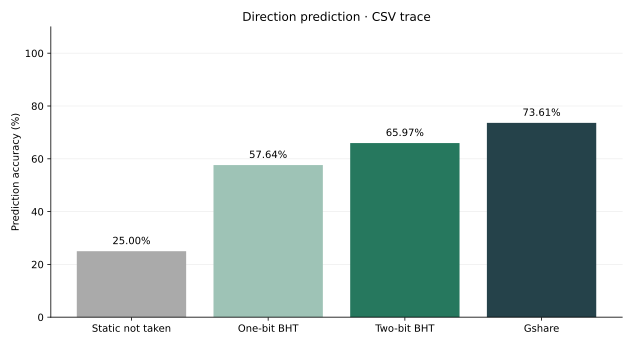
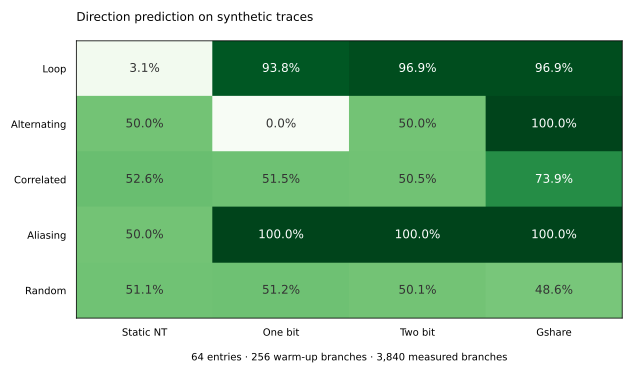
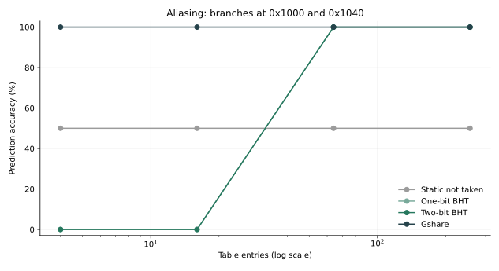

# Branch predictor lab

A Python experiment comparing static-not-taken, one-bit, two-bit saturating-counter, and gshare direction predictors. The starting question is simple: what does a predictor remember, and when does that memory help?

This is a trace-driven software model motivated by RISC-V/FPGA study. It does not run a RISC-V program, modify BOOM, predict branch targets, or measure processor performance.

## Run

Use Python 3.10 or newer. From the repository root:

```sh
python3 -m venv .venv
source .venv/bin/activate
python -m pip install -r requirements.txt
python src/generate_trace.py
python src/benchmark.py --out results
python -m unittest discover -s tests -v
```

Windows activation: `.venv\Scripts\activate`. Run the commands from the repository root.

The committed 144-event example is deterministic: twelve repetitions of an eight-iteration loop, plus a second changing branch. With 16 entries, no warm-up, and an illustrative five-cycle miss penalty:

| Predictor | Accuracy | Mispredictions | Logical state | Penalty cycles only |
| --- | ---: | ---: | ---: | ---: |
| Static not taken | 25.00% | 108 | 0 bits | 540 |
| One-bit BHT | 57.64% | 61 | 16 bits | 305 |
| Two-bit BHT | 65.97% | 49 | 32 bits | 245 |
| Gshare | 73.61% | 38 | 36 bits | 190 |



The first three results reproduce the original starter example. Gshare adds four global-history bits to its sixteen two-bit counters. The table compares equal entry counts, not equal storage budgets.

## Workload and size sweep

```sh
python src/benchmark.py --suite --out results/suite
```

This runs 80 cases: five seeded workloads × four table sizes × four predictors. Each workload contains 4,096 events. The first 256 train the predictor without contributing to the score; 3,840 are measured. Every case starts with fresh state. The seed is 7, and sizes are 4, 16, 64, and 256 entries.



At 64 entries, gshare learns the alternating case and reaches 73.91% on the correlated-pair case. The random control stays near 50% for all predictors; gshare is 48.57% in this particular finite sample. This is a useful limit on what history can accomplish, not a claim that one predictor wins every workload.



The aliasing case gives branches at `0x1000` and `0x1040` opposite fixed outcomes. Their BHT indices collide at 4/16 entries and separate at 64/256. This isolates interference between branches that share an untagged table entry.

See [the full sweep report](results/suite/report.md), [CSV data](results/suite/summary.csv), and [configuration and trace fingerprints](results/suite/metadata.json).

## Models and assumptions

- Static: always predict not taken.
- One bit: start not taken, then remember the last outcome in that index.
- Two bits: start weakly not taken; predict taken for states 2/3, increment on taken, decrement on not taken, saturating at 0/3.
- Gshare: XOR the word PC with global history to select a two-bit counter. Train with the pre-update history, then shift in the actual outcome. History width defaults to `log2(entries)`.
- PC indexing drops two low bits. Inputs must therefore be four-byte aligned; RISC-V compressed instruction addresses are outside this lab's convention.
- Each branch is predicted before its actual outcome updates state. There is no speculation, delayed retirement, rollback, fetch grouping, BTB, or cache model.
- Storage is logical predictor state only. Tags, target addresses, SRAM organization, and control circuitry are excluded.
- `penalty_cycles_only = mispredictions × assumed penalty`. Without a complete instruction count and timing model, this is not CPI, MPKI, runtime, or FPGA speedup.

## Use another trace

```csv
pc,taken
0x100,1
0x104,0
```

PCs may be hexadecimal (`0x...`) or unsigned decimal. Outcomes must be exactly `0` or `1`.

```sh
python src/benchmark.py --trace path/to/trace.csv --entries 64 --warmup 100 --penalty 5 --out results/custom
```

Importing an externally recorded trace does not turn this model into a cycle-accurate CPU simulator. The repository's committed measurements use synthetic inputs only.

## Verification

The 19 standard-library tests cover counter transitions and saturation, deliberate aliasing, gshare's update order and history mask, warm-up scoring, the exact original miss counts, seed reproducibility, CSV validation, and CLI failure for an invalid table size. Re-run with `make test` or the command above. `make run` regenerates both sets of results.

## References

- [BOOM backing predictor documentation](https://docs.boom-core.org/en/latest/sections/branch-prediction/backing-predictor.html): background on global history and counter tables. BOOM's implementation and update timing are more complex than this lab.
- [BOOM terminology](https://docs.boom-core.org/en/latest/sections/terminology.html): gshare and bimodal table definitions.

[Matthew Li's engineering portfolio](https://matthew-li-portfolio.li-matthew01.chatgpt.site)
